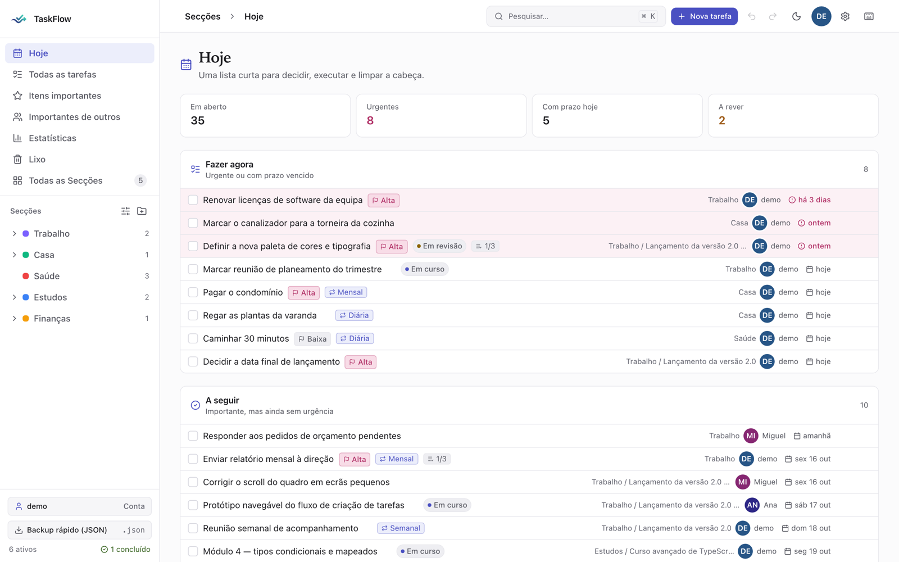
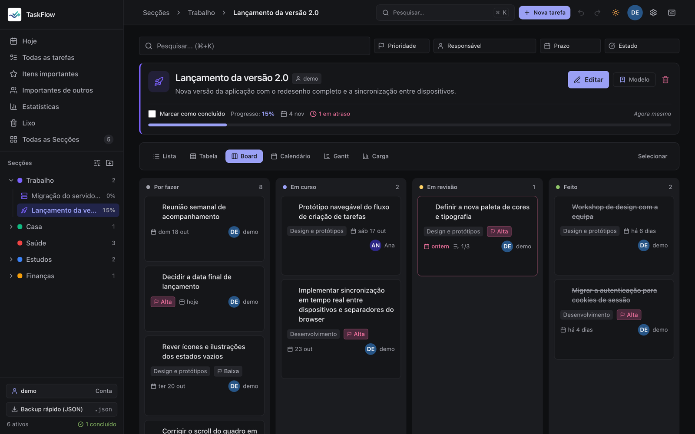
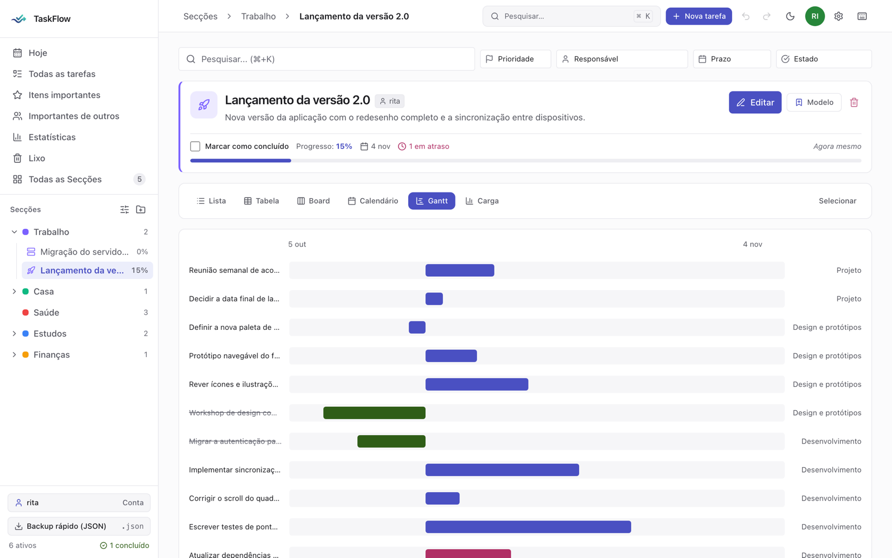
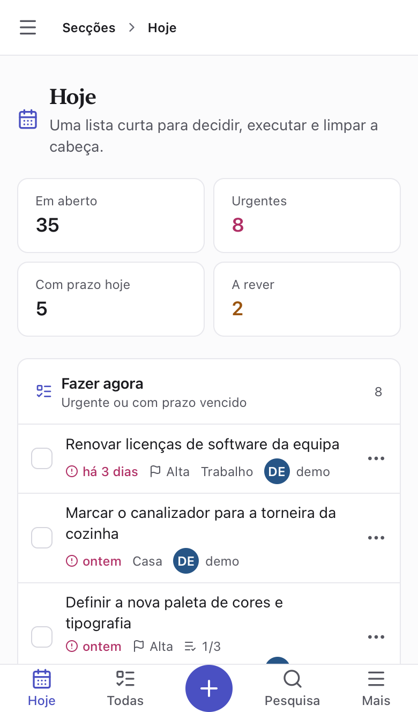
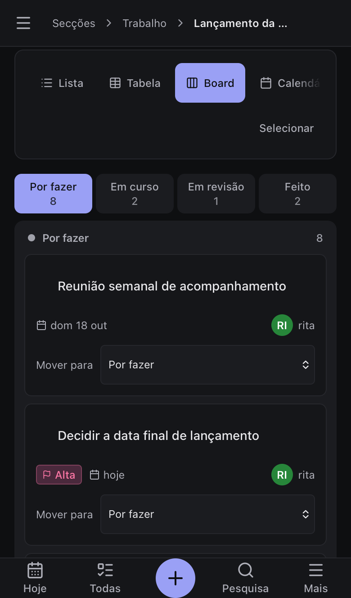

# TaskFlow

> **English:** a personal, self-hosted task manager. Sections › Projects › Subprojects, due dates, recurrence, full-text search, 30-day trash, ntfy reminders and a quick-capture API. Runs as a single Docker container (SQLite, `linux/amd64` and `linux/arm64`, so Raspberry Pi and Apple Silicon work). **The interface is in Portuguese (pt-PT).** The source code is not public; the app is free for personal use and this repository is for installation and feedback. Install: see [Instalar](#instalar) (one `docker run`).

Gestor de tarefas pessoal, em português: **Secções › Projetos › Subprojetos**, prazos, recorrência, pesquisa, lixo com 30 dias, lembretes e captura rápida por API.


É um projeto pessoal, feito com ajuda de IA. O código não é público, mas podes usar a app grátis e dar sugestões aqui.

## Capturas

| Hoje | Board (escuro) | Gantt |
| --- | --- | --- |
|  |  |  |

No telemóvel (barra inferior, folhas e gestos com equivalente por toque):

<p>
  
  
</p>

## Instalar

Precisas de [Docker](https://docs.docker.com/get-docker/).

```bash
docker run -d --name taskflow -p 3000:3000 \
  -v taskflow-data:/app/data --restart unless-stopped \
  ghcr.io/rj-pess/taskflow:latest
```

Abre <http://localhost:3000> e cria a tua conta (a primeira conta é criada no primeiro acesso).

> A imagem é multi-arquitetura (**amd64** e **arm64**): funciona em PCs, Raspberry Pi e Macs com Apple Silicon, sem opções extra.

### Com Docker Compose

```yaml
services:
  taskflow:
    image: ghcr.io/rj-pess/taskflow:latest
    ports: ["3000:3000"]
    volumes: [taskflow-data:/app/data]
    restart: unless-stopped
volumes:
  taskflow-data:
```

## Atualizar

```bash
docker pull ghcr.io/rj-pess/taskflow:latest
docker rm -f taskflow
# volta a correr o comando de instalação
```

Os dados ficam no volume `taskflow-data` e sobrevivem à atualização.

## Backup

A app faz um backup diário (últimos 14) em `data/backups/`. Para copiares tudo para a tua máquina:

```bash
docker cp taskflow:/app/data ./taskflow-backup
```

## Segurança

- A app corre em **HTTP**. Usa-a em rede local ou atrás do teu próprio HTTPS. **Não a expões diretamente à internet.**
- Cada instalação é tua: os teus dados ficam só na tua máquina.

## Sugestões e problemas

- Ideia nova ou melhoria: [abrir sugestão](../../issues/new?template=sugestao.yml)
- Algo não funciona: [reportar bug](../../issues/new?template=bug.yml)

É um projeto pessoal: respondo quando puder, sem prazos.

## Licença

Uso pessoal e gratuito. Ver [LICENSE](LICENSE).
