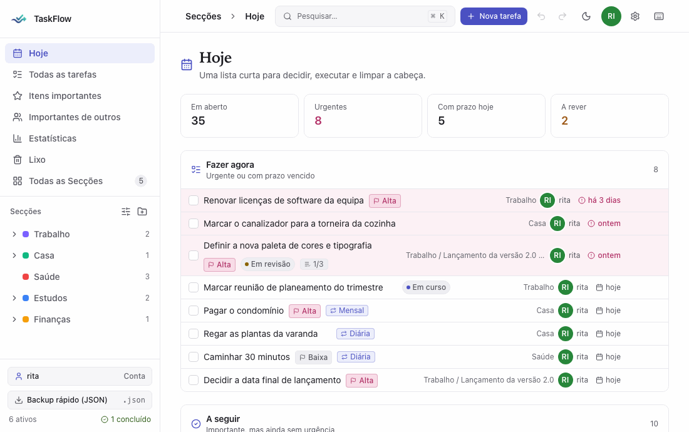
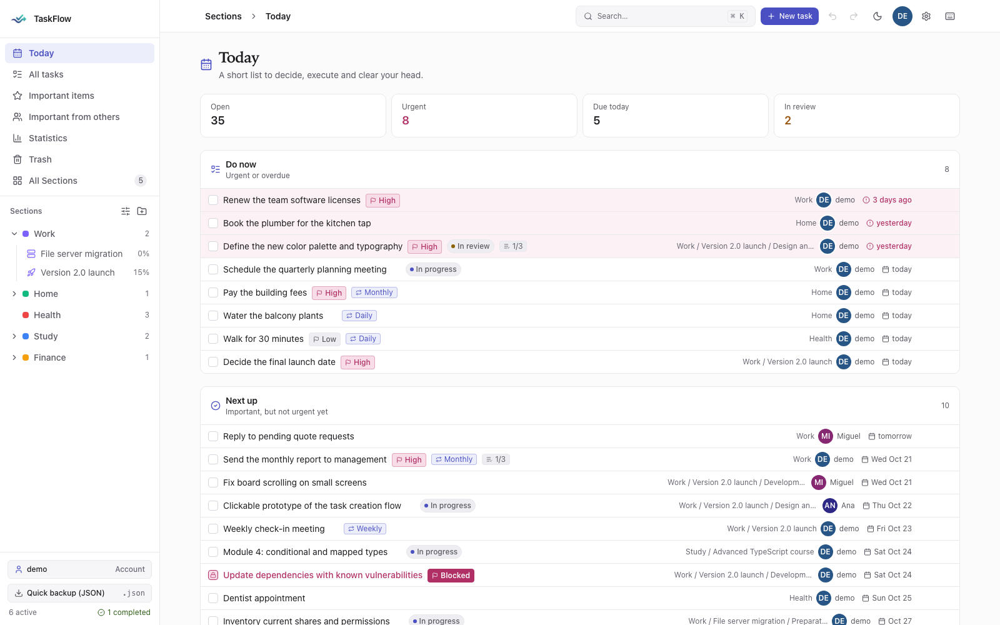
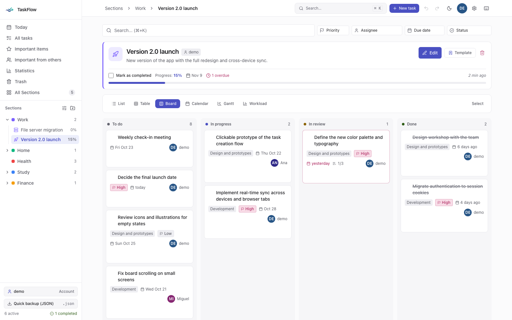
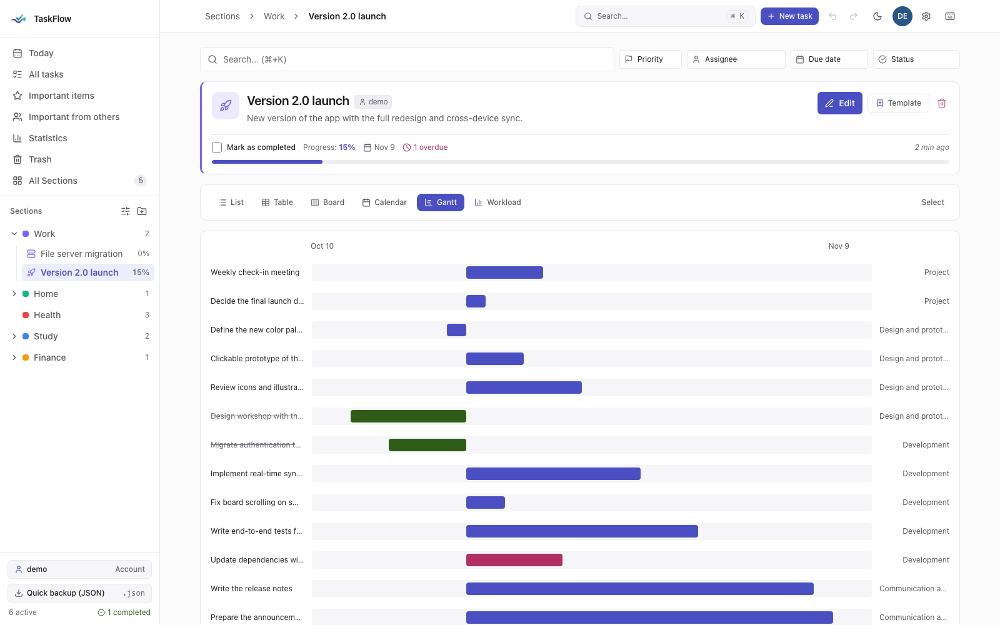
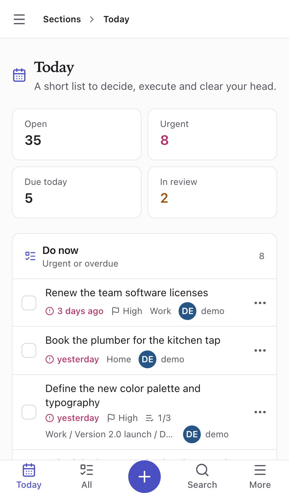
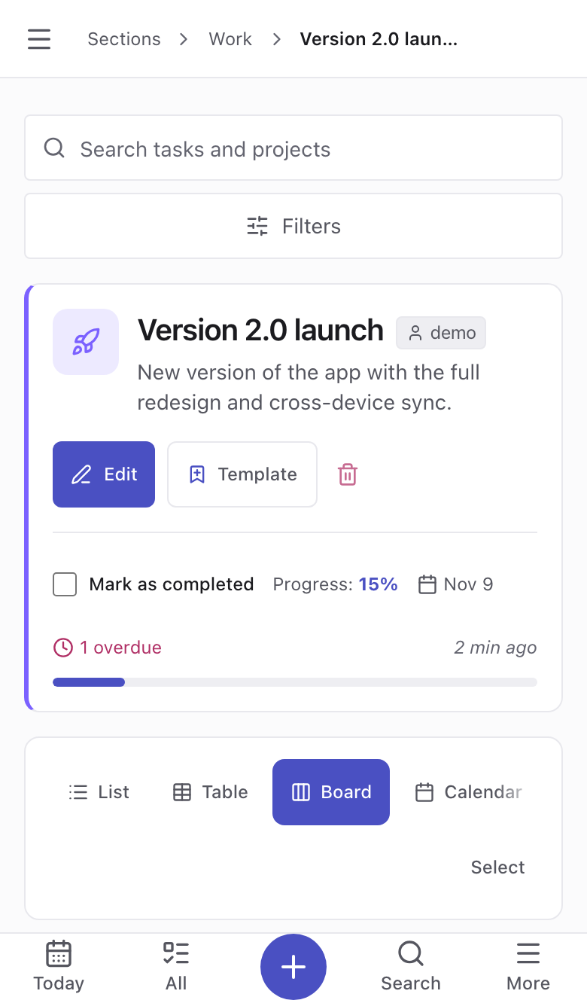
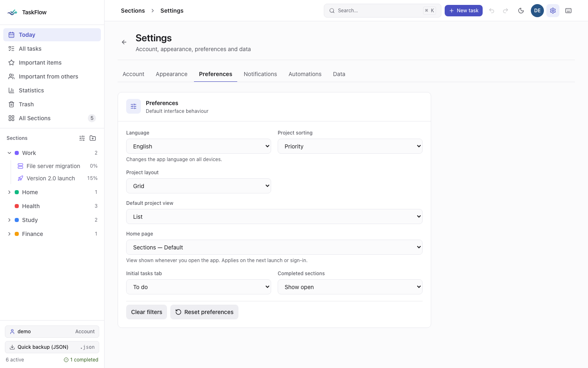

# TaskFlow

A personal, self-hosted task manager: **Sections › Projects › Subprojects**, due dates, recurrence, full-text search, a 30-day trash, reminders and a quick-capture API. It runs as a single Docker container.

I'm Portuguese and I originally built TaskFlow for my own needs, in Portuguese. I then translated the whole interface to English so that **anyone can use it**. The app is available in English and Portuguese (pt-PT); pick the language in *Settings → Preferences → Language*.



## Before you install

- **The source code is closed.** I'm an inexperienced developer and the whole app was built with AI. For now I prefer not to publish the code: what I'm after is feedback from people who use it. The app is free for personal use (see [License](#license)).
- **It's a personal, single-user app.** No teams, sharing or permissions. It runs over **plain HTTP**, so use it at home, on your local network, or behind your own HTTPS.
- **It installs in two minutes**, with no configuration: one command or a `docker-compose.yml` (below).
- **There is no online demo.** The [screenshots](#screenshots) show the app with sample data.
- **Please give feedback!** Any suggestion or bug report helps, see [Feedback](#feedback).

## Screenshots

| Today | Board (dark) | Gantt |
| --- | --- | --- |
|  |  |  |

On mobile (bottom bar, sheets, and gestures that all have a tap equivalent):

<p>
  
  
</p>

## Language

The interface comes in **English** and **Portuguese (Portugal)**. Choose it in *Settings → Preferences → Language*; the choice applies on every device. Reminders and the morning digest follow it, and quick capture (by text or API) understands dates and recurrence in both languages ("tomorrow", "every friday"…).



## Install

You need [Docker](https://docs.docker.com/get-docker/).

```bash
docker run -d --name taskflow -p 3000:3000 \
  -v taskflow-data:/app/data --restart unless-stopped \
  ghcr.io/rj-pess/taskflow:latest
```

Open <http://localhost:3000> and create your account (the first account is created on first visit).

> The image is multi-architecture (**amd64** and **arm64**): it runs on PCs, Raspberry Pi and Apple Silicon Macs with no extra options.

### With Docker Compose

```yaml
services:
  taskflow:
    image: ghcr.io/rj-pess/taskflow:latest
    ports: ["3000:3000"]
    volumes: [taskflow-data:/app/data]
    restart: unless-stopped
volumes:
  taskflow-data:
```

## Update

```bash
docker pull ghcr.io/rj-pess/taskflow:latest
docker rm -f taskflow
# run the install command again
```

Your data lives in the `taskflow-data` volume and survives updates.

## Backup

The app makes a daily backup (the last 14 are kept) in `data/backups/`. To copy everything to your machine:

```bash
docker cp taskflow:/app/data ./taskflow-backup
```

## Security

- The app runs over **HTTP**. Use it on a local network or behind your own HTTPS. **Do not expose it directly to the internet.**
- Every installation is yours: your data stays on your own machine.

## Feedback

- A new idea or improvement: [open a suggestion](../../issues/new?template=suggestion.yml)
- Something doesn't work: [report a bug](../../issues/new?template=bug.yml)

This is a personal project: I reply when I can, with no deadlines.

## License

Free for personal use. See [LICENSE](LICENSE).
